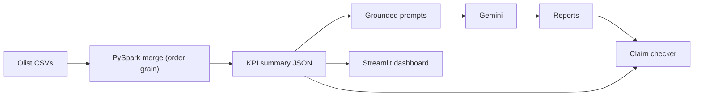
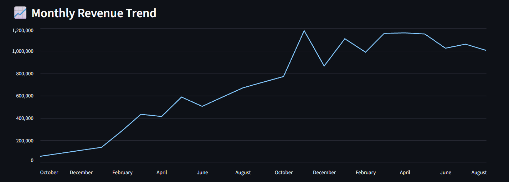

# LLM Business Insights

Turns raw e-commerce data into executive-style business reports. PySpark computes verified KPIs, and Gemini turns them into written analysis. Built on the Olist Brazilian e-commerce dataset (~100K orders, 2016-2018).

## How it works



1. `src/spark/joins.py` merges 8 Olist tables, aggregating payments and reviews to one row per order first
2. `src/spark/transform.py` and `feature_engineering.py` clean data and derive delivery, delay and revenue features
3. `src/spark/kpis.py` computes revenue, customer, order, product, payment, review, geography and seller KPIs into `data/processed/business_summary.json`
4. `src/llm/prompts.py` builds prompts that state currency, data coverage and partial months, and forbid unsupported claims
5. `src/llm/generate_insights.py` calls Gemini with a timeout and retry/backoff
6. `cli.py` (menu) and `app.py` (Streamlit) generate the reports in `outputs/`

## Setup

Requires Python 3.10+ and Java 17+ (for PySpark).

```bash
pip install -r requirements.txt
```

1. Download the [Olist dataset](https://www.kaggle.com/datasets/olistbr/brazilian-ecommerce) and put the CSVs in `data/raw/olist_dataset/`
2. Create a `.env` file:
   ```
   GEMINI_API_KEY=your_key
   GEMINI_MODEL=gemini-3.7-flash   # optional
   ```

## Run

```bash
python -m src.spark.kpis          # build KPIs -> data/processed/business_summary.json
python cli.py                     # command-line report generator
python -m streamlit run app.py    # web dashboard
pytest -v                         # tests
```

## Key results (Olist, Oct 2016 - Aug 2018)

- Revenue R$15.84M across 99,441 orders; AOV R$160.58
- 3.12% repeat purchase rate; SP generates 37% of revenue
- Average review 4.09; average delivery 12.5 days; 6.57% of orders delivered late

## Engineering notes

Bugs found and fixed while validating the pipeline:

- **Join fan-out:** payments and reviews were joined onto item-level rows, inflating revenue from R$15.84M to R$16.64M. Fixed by aggregating both to one row per order before joining, and covered by tests.
- **Wrong grain for order-level KPIs:** review counts and averages were computed on item rows (112,464 "reviews" vs 99,224 real). They now use one row per order.
- **LLM misreading data edges:** the model reported a "revenue collapse" in Sep/Oct 2018, which is just where the dataset ends. Prompts now state the currency, the reliable data window and the partial months, and the dashboard chart hides them.
- **Pandas to PySpark consolidation:** the KPIs were first implemented twice. Before deleting the pandas version I compared both outputs (255 values); they matched except for the delay definition, where Spark counts calendar days.
- **Claim checker:** extracts every number from a generated report and traces it to the KPI JSON, directly or as a derived share, sum or ratio. About 97% of numbers across the five reports traced, and it caught three arithmetic slips by the model (for example 98,665 reviews where the KPI says 98,673).

Delayed = delivered on a later calendar day than estimated; the percentage is measured against all orders.

## Known limitations / next steps

- Reports in `outputs/` are raw model output. The claim checker flagged 3 arithmetic slips in them (e.g. 98,665 reviews vs 98,673); they are left uncorrected to show what the checker catches.
- Custom questions only use the KPI summary. Planned: retrieval over customer review comments (RAG) to ground "why" explanations, and tool calling for questions the KPIs can't answer.
- Spark is used for scalability of the design; at 100K rows pandas would also suffice
- Gemini's free tier (20 requests/day per model) limits live generation, so reports are pre-generated in `outputs/`

## Screenshot

